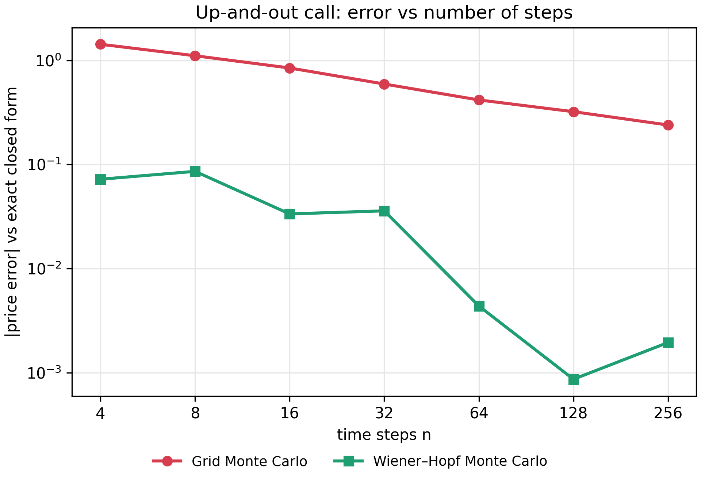

# Wiener–Hopf Monte Carlo for barrier options — Aneurin Quinn

A small, Dockerised research code that prices **knock-out barrier call options
under Black–Scholes** with **Wiener–Hopf Monte Carlo** (WHMC), and a talk on the
good-practice methods used to write it.



## The problem

A barrier option dies if the stock price ever crosses a barrier before
maturity. The textbook Monte Carlo method simulates the stock on a time grid
and only checks the barrier at grid points, so it **misses crossings between
grid points** and overprices knock-out options. The error shrinks only like
1/√n in the number of time steps.

## The method

Wiener–Hopf Monte Carlo (Kuznetsov, Kyprianou, Pardo & van Schaik, 2011) steps
through the path at independent exponential times. At an exponential time the
Wiener–Hopf factorisation gives the **maximum** of the path and the **drop
after it** as two independent exponential random variables, so each step,
including its maximum, is simulated exactly. For Black–Scholes (Brownian motion
with drift μ = r − σ²/2 in log-space) the rates are explicit:

    phi± = ( sqrt(mu² + 2 q sigma²) ∓ mu ) / sigma²,   q = n / T

After n steps the simulation sits at a random time g_n ~ Gamma(n, n/T), which
concentrates at T as n grows.

## Results (S0 = 100, K = 100, H = 130, r = 5%, σ = 20%, T = 1, 200,000 paths)

Exact continuously monitored price (Reiner–Rubinstein closed form): **3.3329**

| steps | WHMC error | grid MC error |
|------:|-----------:|--------------:|
| 4     | +0.072     | +1.427        |
| 16    | +0.034     | +0.844        |
| 64    | +0.004     | +0.416        |
| 256   | −0.002     | +0.239        |

Monte Carlo noise is about ±0.027 (95%). Both methods take the same time per step.

## Good-practice methods used (the talk)

| Method | Where in the code |
|---|---|
| **Choose appropriate parameters** | `choose_steps` picks the smallest step count whose bias is inside the Monte Carlo noise (64); `whmc_price_to_tolerance` picks the number of paths for a target standard error (380,000 for 0.01). Simulation sizes are keyword-only so `n_steps` and `n_paths` can't be swapped. |
| **Comments and docstrings** | Every function says what it returns (shapes, units) and comments explain *why*, e.g. why `norm_cdf` uses `erfc`. |
| **Small numbers: one dedicated function** | `erfc` instead of `1 + erf` (N(−10) is 7.6e-24, not 0), `expm1` instead of `1 − exp` in the Brownian bridge, and a cancellation-free formula for φ⁺. Tested against a 50-digit `Decimal` reference. |
| **Good-resolution graphs, saved as vector files** | `plot_convergence` saves a 300 dpi PNG and an SVG, with labelled log axes. |
| **Reproducible environment** | Python and every library pinned in Docker; each run saves Python/NumPy/Matplotlib versions and the seed to `run.json`. |
| Also (Effective Python Ch. 1) | f-strings for all output, unpacking (`phi_plus, phi_minus = ...`), `zip(..., strict=True)` for the results table, `:=` in the run-until-accurate loop. |

Slides: [`Pythonic_Thinking_AQ.pptx`](Pythonic_Thinking_AQ.pptx)

## Code

| File | What it does |
|---|---|
| [`whmc/black_scholes.py`](whmc/black_scholes.py) | Market/option dataclasses, vanilla and closed-form barrier prices |
| [`whmc/wiener_hopf.py`](whmc/wiener_hopf.py) | Wiener–Hopf factors and the WHMC path simulator |
| [`whmc/monte_carlo.py`](whmc/monte_carlo.py) | WHMC, grid MC and Brownian-bridge estimators; adaptive number of paths |
| [`whmc/plotting.py`](whmc/plotting.py) | Convergence plot, saved as 300 dpi PNG and SVG |
| [`run_pricing.py`](run_pricing.py) | The demo: exact price, convergence table, parameter choice, precision checks, figures, `run.json` |
| [`tests/test_whmc.py`](tests/test_whmc.py) | 31 pytest checks |
| [`figures/`](figures/) | Output of the Docker run: `convergence.png`, `convergence.svg`, `run.json` |

## Run it

```bash
docker build -t whmc-barrier .
docker run --rm whmc-barrier                                    # price + convergence study
docker run --rm -v "$PWD/figures:/app/results" whmc-barrier     # ...and save the figures here
docker run --rm whmc-barrier python run_pricing.py --barrier 120
docker run --rm whmc-barrier python -m pytest -q tests          # 31 tests
```

Locally (Python 3.10+): `pip install -r requirements.txt && python run_pricing.py`
